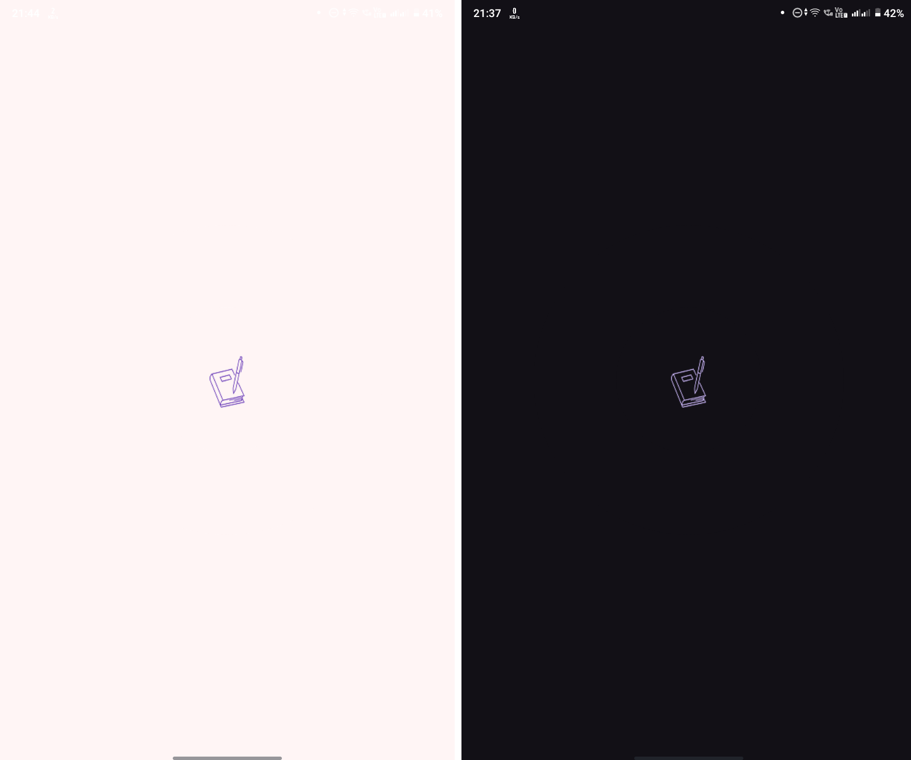
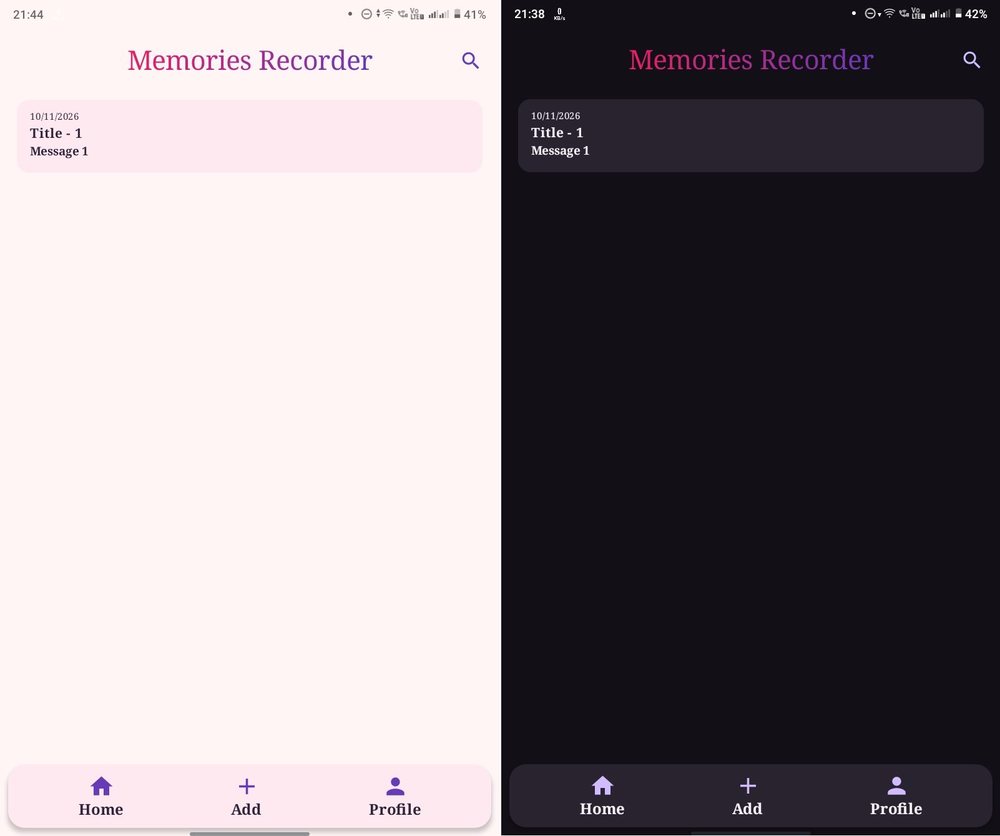
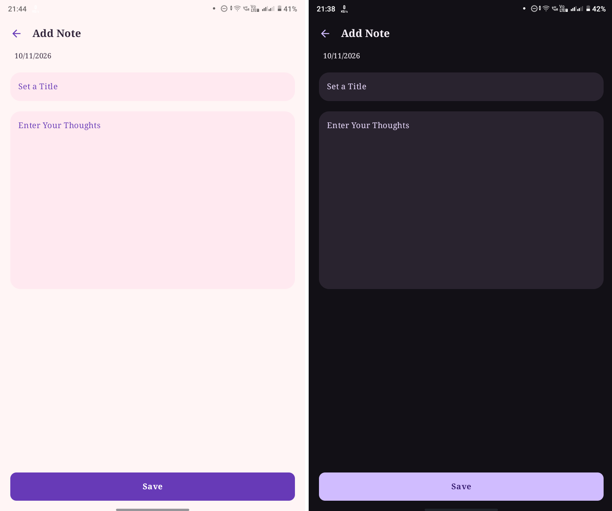
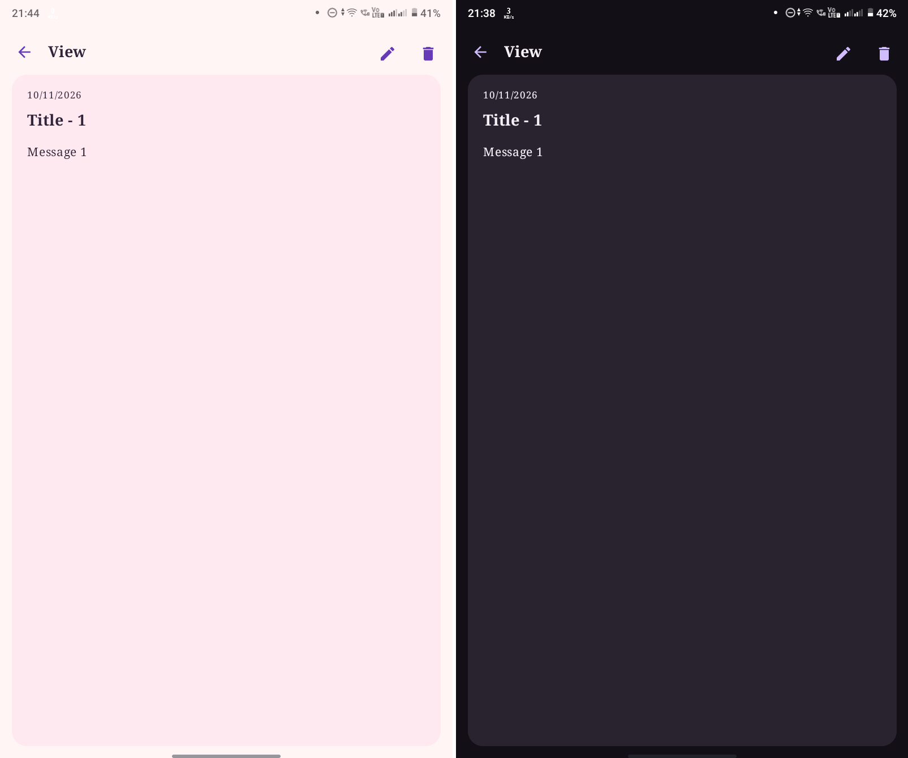
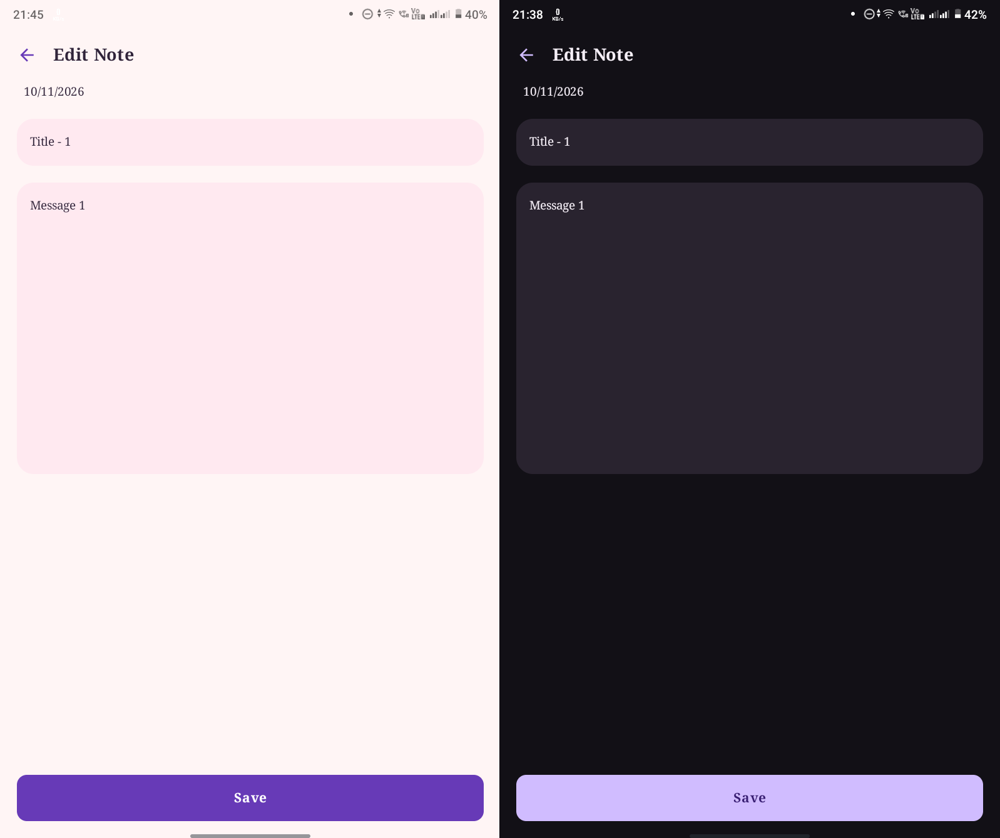
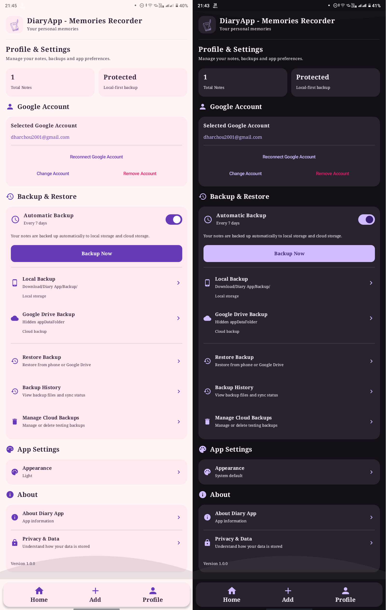
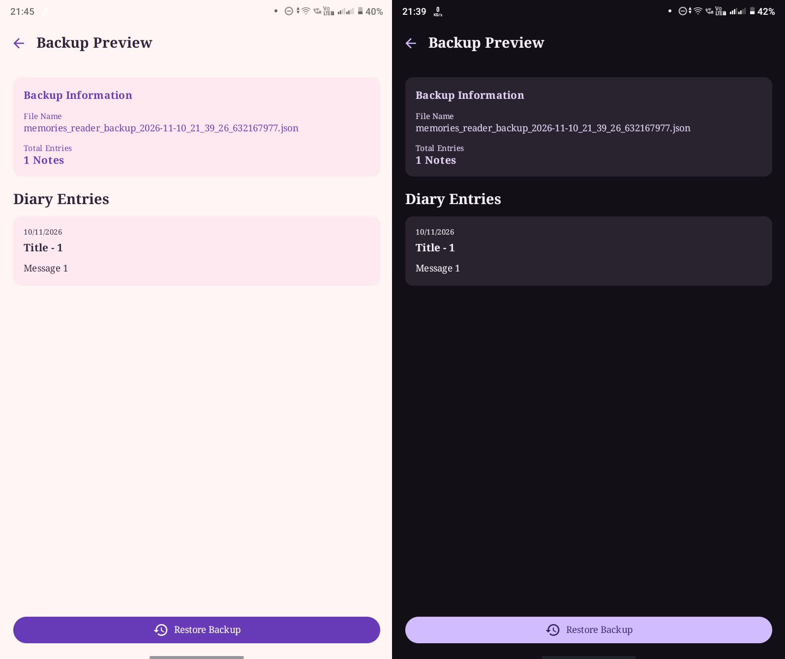

# 📔 DiaryApp

A personal diary and memories management Android application built using Kotlin and Jetpack Compose.

DiaryApp allows users to create, manage, and revisit their personal memories while providing local
and cloud backup options to help keep their data safe.

## ✨ Features

- Create and save diary entries
- View saved memories
- Edit and manage diary entries
- Local data storage
- Local backup and restore
- Automatic local backup
- Backup history and preview
- Backup notifications
- Google Drive cloud backup and restore (Limited Testing Access)
- Light and Dark theme support

## ☁️ Cloud Backup Availability

Google Drive backup and restore are currently in testing mode.

- Access is currently limited to authorized Google test accounts.
- General Google account access is not available yet.
- To request testing access, please contact the developer.

## 🛠️ Tech Stack

- **Language:** Kotlin
- **UI:** Jetpack Compose
- **Architecture:** MVVM
- **Database:** Room
- **Background Tasks:** WorkManager
- **Cloud Integration:** Google Drive

## 📱 Download & Installation

You can download the latest available APK from:

[Download DiaryApp APK](release/DiaryApp-v1.0.0.apk)

Installation steps:

1. Download the APK file.
2. Open the downloaded APK on your Android device.
3. Allow installation from unknown sources if prompted.
4. Complete the installation and open DiaryApp.

## 📸 Screenshots

### Splash Screen



### Home Screen



### Add Note Screen



### View Screen



### Edit Note Screen



### Profile Screen



### Backup Preview Screen



## 🎥 Screen Recording

Watch the complete DiaryApp demonstration:

[▶ Watch DiaryApp Demo](screen-recording/DiaryApp-Demo.mp4)
Click on "View Raw" option.

## 📂 Project Structure

```text
DiaryApp/
├── app/
│   └── src/
│       └── main/
│           ├── java/com/example/diaryapp/
│           │   ├── data/
│           │   ├── model/
│           │   ├── ui/
│           │   ├── view/
│           │   ├── worker/
│           │   ├── MainActivity.kt
│           │   └── MainViewModel.kt
│           └── res/
├── screenshots/
│   ├── splash-screen.png
│   ├── home-screen.png
│   ├── add-note-screen.png
│   ├── view-screen.png
│   ├── edit-note-screen.png
│   ├── profile-screen.png
│   └── backup-preview-screen.png
├── screen-recording/
│   └── DiaryApp-Demo.mp4
├── release/
│   └── DiaryApp-v1.0.0.apk
├── gradle/
├── README.md
└── build.gradle.kts
```

## 🚀 Future Improvements

- Improve cloud backup accessibility
- Enhance backup management
- Add more diary customization options
- Further UI and performance improvements

## 👨‍💻 Developer

**Dharmanshu Chouhan**

Android Developer | Kotlin | Jetpack Compose

---

⭐ If you find this project interesting, feel free to explore the source code.
